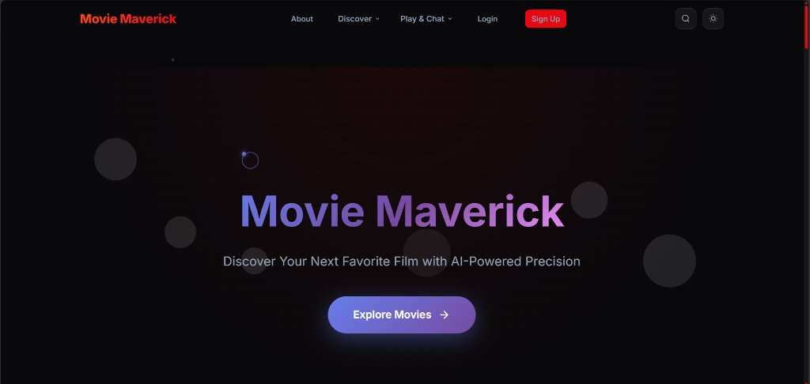
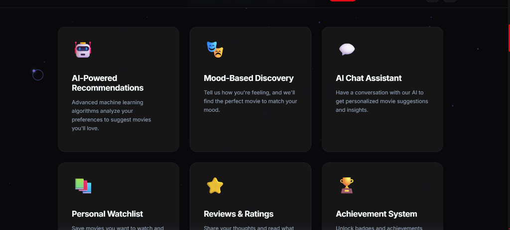
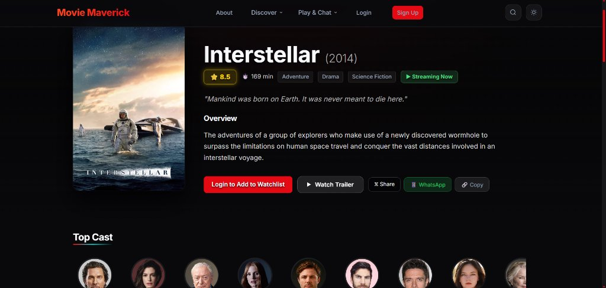

# Movie Maverick - Advanced AI Movie Recommendation Platform 🎬

<div align="center">

[](https://www.python.org/)
[](https://flask.palletsprojects.com/)
[](https://makersuite.google.com/)
[](https://www.themoviedb.org/)
[](https://www.postgresql.org/)
[](https://www.docker.com/)
[](https://opensource.org/licenses/MIT)


<p align="center">
  <b>A comprehensive, enterprise-grade movie recommendation and discovery platform with AI-powered suggestions, mood-based exploration, social features, and rich analytics. Built with Flask, Scikit-learn, PostgreSQL / SQLite, Redis, TMDB API, and Google Gemini.</b>
</p>

</div>

---

## 📸 Screenshots & UI Showcase

<div align="center">

### 🌟 Landing Page & Discovery Portal
*Sleek, dark-mode user interface designed for effortless movie browsing and discovery.*



<br/>

### 🤖 Core Feature Suite & AI Tools
*AI-powered recommendations, mood-driven matching, conversational Gemini assistant, personal watchlists, and community achievements.*



<br/>

### 🎬 In-Depth Movie Details & Cast Hub
*Real-time streaming availability, TMDB ratings, cast avatars, trailers, and one-click watchlist actions.*



</div>

---

## ✨ Features

### 🎯 Recommendation Engines
- **Hybrid Recommendation Engine** - Intelligently blends Collaborative Filtering, Content-Based Filtering (TF-IDF cosine similarity), and Popularity-based scoring.
- **AI-Powered Chat Assistant** - Conversational film discovery powered by Google Gemini AI.
- **Mood-Based Recommendations** - "Modyverse" module to find movies that match how you feel right now.
- **Multi-Criteria Advanced Search** - Filter dynamically by genre, release year, minimum rating, actors, and directors.
- **Interactive World Map** - Explore and discover top cinematic titles by country of origin across the globe.
- **TMDB Integration** - Live movie posters, trailers, backdrop artwork, plot overviews, and crew details.

### 👥 Social & Community
- **User Profiles** - Customizable profiles with avatars, bios, and favorite genres.
- **Follow System & Activity Feed** - Follow friends and see what films they're watching, reviewing, and liking.
- **Reviews & Ratings** - Rate films on a 1-10 scale and publish rich reviews.
- **Social Interactions** - Upvote and comment on community movie reviews.
- **Curated Movie Lists** - Build, organize, and share custom public or private movie collections.

### 🏆 Gamification & Notifications
- **Achievement Badges** - Unlock milestone badges (e.g., Critic, Genre Explorer, Cinephile).
- **In-App Real-Time Alerts** - Notifications for follows, likes, badges, and review comments.
- **Notification Preferences** - Granular toggles to customize your alert feed.

### 📊 Analytics & Viewing History
- **Personal Viewing History** - Keep track of every movie you have watched.
- **Search History** - Rapidly access and re-run your previous searches.
- **Genre Insights** - Automatic visualization and breakdown of your favorite genres.

### 🔒 Security & Performance
- **Rate Limiting** - Flask-Limiter integration to prevent brute force and API abuse.
- **Input Validation & Sanitization** - Schemas backed by Marshmallow and Bleach HTML sanitization for XSS prevention.
- **CSRF & Session Security** - Secure HTTP-only cookies, SameSite enforcement, and Flask-WTF CSRF tokens.
- **Intelligent Caching** - Redis-backed cache layer for rapid response times.
- **Database Flexibility** - Seamlessly switch between SQLite for lightweight local development and PostgreSQL for production.

---

## 🚀 Quick Start

### Prerequisites
- **Python 3.11+**
- **TMDB API Key** ([Get a free key here](https://www.themoviedb.org/settings/api))
- **Google Gemini API Key** ([Get a key here](https://aistudio.google.com/app/apikey))
- *Optional:* Docker & Docker Compose (for containerized deployments)

---

### Local Development Setup

1. **Clone the Repository**
   ```bash
   git clone https://github.com/farhan4783/Movies_recomendation.git
   cd Movies_recomendation
   ```

2. **Create & Activate a Virtual Environment**
   - **On Windows (PowerShell):**
     ```powershell
     python -m venv .venv
     .\.venv\Scripts\Activate.ps1
     ```
   - **On Windows (CMD):**
     ```cmd
     python -m venv .venv
     .\.venv\Scripts\activate.bat
     ```
   - **On macOS / Linux:**
     ```bash
     python3 -m venv .venv
     source .venv/bin/activate
     ```

3. **Install Dependencies**
   ```bash
   pip install -r requirements.txt
   ```

4. **Configure Environment Variables**
   ```bash
   cp .env.example .env
   ```
   Edit `.env` with your API keys:
   ```env
   FLASK_ENV=development
   SECRET_KEY=your_secret_key_here
   DEV_DATABASE_URL=sqlite:///database.db
   DATABASE_URL=sqlite:///database.db
   TMDB_API_KEY=your_tmdb_api_key_here
   GEMINI_API_KEY=your_gemini_api_key_here
   ```

5. **Run the Application**
   ```bash
   python app.py
   ```

6. **Open in Browser**
   - **Main App:** [http://127.0.0.1:5000](http://127.0.0.1:5000)
   - **Explore & Recommendations:** [http://127.0.0.1:5000/explore](http://127.0.0.1:5000/explore)
   - **Health Check:** [http://127.0.0.1:5000/health](http://127.0.0.1:5000/health)

---

### Production Deployment with Docker

1. **Configure Production Variables** in `.env`:
   ```env
   FLASK_ENV=production
   SECRET_KEY=generate-a-strong-random-key
   DATABASE_URL=postgresql://user:password@db:5432/moviemaverick
   POSTGRES_PASSWORD=your_secure_db_password
   TMDB_API_KEY=your_tmdb_api_key
   GEMINI_API_KEY=your_gemini_api_key
   ```

2. **Build and Launch Containers**
   ```bash
   docker-compose up -d --build
   ```

3. **Initialize the Database**
   ```bash
   chmod +x scripts/*.sh
   ./scripts/init_db.sh
   ```

4. Access the production server at `http://localhost:5000`.

---

## 📁 Project Structure

```
Movies_recomendation/
├── app.py                      # Main Flask application entry point & routing
├── config.py                   # Environment configuration (Dev, Test, Prod)
├── Dockerfile                  # Production container definition
├── docker-compose.yml          # Multi-container orchestration (App, Postgres, Redis)
├── requirements.txt            # Python dependencies
├── .env.example                # Sample environment variables file
│
├── static/                     # CSS, JS, and client assets
│   ├── screenshots/           # Application preview images & UI showcase
│   │   ├── hero_landing.jpg   # Landing page hero banner
│   │   ├── features.png       # Feature highlights & AI overview
│   │   └── movie_details.jpg  # Movie detail, metadata & cast view
│   ├── style.css              # Main stylesheet
│   ├── animations.js          # Interactive UI animations
│   └── premium.css            # Dark theme styles
│
├── model/                      # Machine learning & data models
│   ├── models.py              # SQLAlchemy database models
│   ├── recommenders.py        # Content, collaborative & hybrid engines
│   └── ai_recommender.py      # Google Gemini AI integrations
│
├── routes/                     # Blueprint modular route handlers
│   ├── social.py              # Social feeds, follow system, user lists
│   └── notifications.py       # User notification endpoints
│
├── middleware/                 # Security and request validation
│   ├── validators.py          # Marshmallow schemas
│   └── security.py            # Security headers and sanitization
│
├── utils/                      # Helper utilities
│   ├── tmdb_client.py         # TMDB API queries & caching
│   ├── achievements.py        # Gamification & badges logic
│   ├── cache.py               # Redis caching helper
│   ├── notification_service.py # Push & email notification service
│   └── streaming_availability.py # Watch provider lookups
│
├── templates/                  # Jinja2 HTML templates
│   ├── about.html             # Landing page
│   ├── index.html             # Explore & recommendation view
│   ├── movie_details.html     # Movie info, reviews, trailers & cast
│   ├── profile.html           # User profile & statistics
│   ├── worldmap.html          # Interactive world map
│   └── ...
│
├── scripts/                    # Automation scripts
│   ├── deploy.sh              # Production deployment helper
│   ├── backup.sh              # Database backup utility
│   └── init_db.sh             # Database initialization script
│
└── data/                       # Datasets for offline ML recommendations
    ├── movies_enriched.csv    # Pre-processed movie metadata
    └── ratings.csv            # User movie ratings
```

---

## 🔧 Environment Variables Reference

| Variable | Description | Required | Default |
|:---------|:------------|:--------:|:--------|
| `FLASK_ENV` | Environment (`development`, `production`, `testing`) | No | `development` |
| `SECRET_KEY` | Flask cryptographic session secret | **Yes** | Auto-generated in dev |
| `DATABASE_URL` | SQLAlchemy database connection URI | **Yes** | `sqlite:///database.db` |
| `DEV_DATABASE_URL` | Development database fallback | No | `sqlite:///database.db` |
| `REDIS_URL` | Redis cache and session URL | No | `redis://localhost:6379/0` |
| `TMDB_API_KEY` | The Movie Database (TMDB) API Key | **Yes** | — |
| `GEMINI_API_KEY` | Google Gemini Generative AI API Key | **Yes** | — |
| `SENTRY_DSN` | Sentry error monitoring DSN | No | — |
| `MAIL_SERVER` | SMTP server for notification emails | No | `smtp.gmail.com` |
| `MAIL_USERNAME` | SMTP username | No | — |
| `MAIL_PASSWORD` | SMTP password | No | — |
| `LOG_LEVEL` | Application logging level (`DEBUG`, `INFO`, `WARNING`) | No | `INFO` |

---

## 🧪 Testing

Run unit and integration tests using `pytest`:

```bash
# Run test suite
pytest

# Run tests with coverage report
pytest --cov=. --cov-report=term-missing

# Test app startup and index route
python test_app_fix.py
```

---

## 🔐 Security Features

- **XSS Sanitization:** User reviews and descriptions are cleaned using Bleach before rendering.
- **CSRF Tokens:** All form submissions are protected via Flask-WTF.
- **SQL Injection Safeguards:** Database interactions execute through SQLAlchemy parameterized ORM queries.
- **Security Headers:** Flask-Talisman configures CSP, HSTS, and frame protections.
- **Secure Password Hashing:** User passwords are encrypted using Scrypt / Werkzeug password hashing.
- **API Rate Limiting:** Sensitive endpoints and AI chats are rate-limited to avoid abuse.

---

## 🗺️ Roadmap

- [ ] Native Mobile App (React Native)
- [ ] Real-time Watch Parties with live chat
- [ ] Direct streaming deep links (Netflix, Prime, Disney+)
- [ ] Transformer-based contextual movie embeddings
- [ ] Multi-language subtitle & localized movie support

---

## 🤝 Contributing

Contributions, feature requests, and bug reports are welcome!

1. Fork the Project
2. Create your Feature Branch (`git checkout -b feature/AmazingFeature`)
3. Commit your Changes (`git commit -m 'Add AmazingFeature'`)
4. Push to the Branch (`git push origin feature/AmazingFeature`)
5. Open a Pull Request

---

## 📝 License

Distributed under the **MIT License**. See `LICENSE` for more information.

---

## 👨‍💻 Author & Contact

**Farhan**  
- 📧 Email: [mohdfarhan4002@gmail.com](mailto:mohdfarhan4002@gmail.com)  
- 💼 LinkedIn: [mohdfarhansde](https://www.linkedin.com/in/mohdfarhansde/)  
- 🐙 GitHub: [@farhan4783](https://github.com/farhan4783)

---

## 🙏 Acknowledgments

- [The Movie Database (TMDB)](https://www.themoviedb.org/) for movie data and poster art.
- [Google Gemini API](https://ai.google.dev/) for state-of-the-art conversational recommendation models.
- [Flask Community](https://flask.palletsprojects.com/) and [Scikit-learn](https://scikit-learn.org/) contributors.
